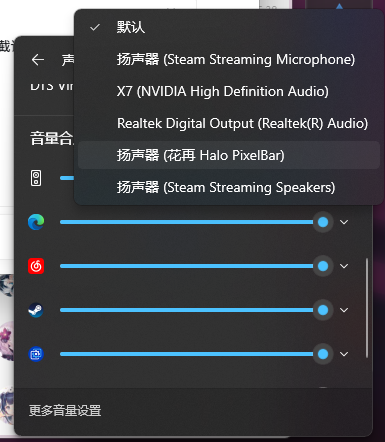

# Native Audio Router for Windows 11

Native Audio Router 为 Windows 11 快捷设置的原生应用音量行加入设备菜单。当前预览 `0.0.5` 支持选择一个输出端点或跟随系统默认，使用 Windows 自身的逐应用输出设置。多设备镜像仍在独立探针阶段。

主分支包含 `0.0.6` Windhawk 审核候选。已发布的预览版在 Releases 中单独提供。

## 实机截图

**任务栏快捷设置中的逐应用输出菜单**



**Windows 设置中的原生音量合成器**

这里可以查看 Windows 的逐应用输出设置，与任务栏菜单中的选择进行对照。


## Windhawk 预览

从 [GitHub Releases](https://github.com/KKKKeybird/native-audio-router/releases) 下载 `native-audio-router.wh.cpp`，在 Windhawk 的本地模块编辑器中粘贴并编译。先打开一次任务栏快捷设置以加载 `ControlCenter.dll`，启用后重新进入声音输出页。若该页在启用前已经打开，将焦点移到任意应用音量行。部分应用需要重新开始播放才能迁移现有音频流。

也可使用仓库中的 [单文件模块源码](dist/native-audio-router.wh.cpp)。

## 从源码构建

```powershell
./scripts/build.ps1
./scripts/build.ps1 -WindhawkRoot $windhawkDirectory
```

第二条命令使用已有 Windhawk 安装的 Clang 生成本地 DLL。预览仅在布局结构与符号匹配时添加菜单。当前运行验证限 Windows 11 x64 构建 `26300.9974`。恢复目前依赖还可访问的行模型，应用退出或者 Shell 重启后的恢复仍待实现。

| 文档 | 内容 |
| --- | --- |
| [调研](docs/RESEARCH.md) | 参考源码、许可证、本机符号与实验结果 |
| [架构](docs/ARCHITECTURE.md) | UI、应用身份、策略恢复和镜像的边界 |
| [兼容性](docs/COMPATIBILITY.md) | 已检验的构建和实际验证范围 |
| [测试](docs/TESTING.md) | 编译、复现实验和各阶段验收 |

## 构建探针

在 PowerShell 中运行以下命令。需要 Visual Studio x64 C++ Build Tools 和包含 `audioclientactivationparams.h` 的 Windows SDK。

```powershell
./scripts/build-probe.ps1
./out/audio-probe.exe
```

默认运行枚举活动输出端点，并读取探针自身的逐应用策略。镜像实验和 XAML 诊断见测试文档。

## English

Native Audio Router is an experimental Windhawk extension for the Windows 11 Quick Settings volume mixer. The current preview adds a native per-app output menu. The separate Core Audio probe exercises policy readback and process-loopback fan-out to explicitly selected output endpoints. See [test procedures](docs/TESTING.md) for build and run commands.
