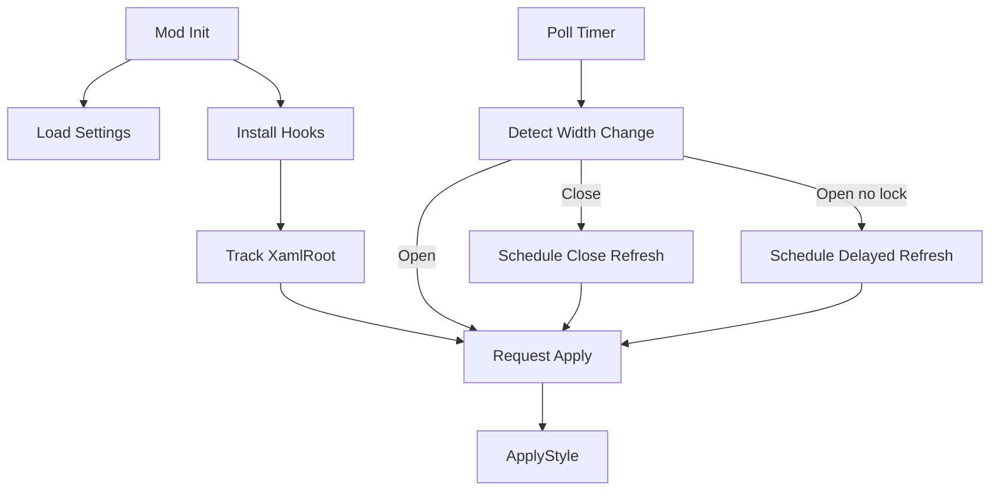

# Windows 11 Better Ultrawide Taskbar: Architecture And Runtime

This is the single source-of-truth doc for the current implementation in `mods/windows-11-better-ultrawide-taskbar.wh.cpp`.

## Goals

1. Keep taskbar centering stable on modern Windows 11 builds.
2. Keep features modular with independent apply and unload behavior.
3. Support primary-only and all-monitor modes.
4. Use one refresh scheduler path for poll, delayed-open, and delayed-close behavior.

## Runtime Flow



## Core Architecture

### Root Tracking

- Roots are tracked in `g_trackedTaskbarRoots`.
- The primary fallback root is cached in `g_cachedPrimaryXamlRoot`.
- Previously applied roots are tracked in `g_appliedXamlRoots` for safe unload replay.
- `IsTaskbarXamlRootEnabled` gates roots based on `Compatibility.applyToAllMonitors`.

### Per-Root State

Each taskbar root has a `TaskbarInstanceState` in `g_rootLayoutStates`:

- Layout history: `previousTaskbarButtonsWidth`, `firstLayoutComplete`.
- Poll history: `lastPolledButtonsWidth`.
- Animation suppression: `animationSuppressDirectUntil`.
- Scheduler state: delayed and close due ticks plus generation tokens.
- Debounce state: `lastApplyTick` (per-root debounce).

### Snapshot + Layout Plan

- `TryBuildTaskbarSnapshot` resolves required elements and geometry for one root.
- `BuildLayoutPlan` computes:
  - `halfGap`
  - `taskbarTransformX`
  - `systemTrayTransformX`
  - `effectiveTotalWidth`

No XAML writes happen in layout math.

### Feature Modules

- `CenterPositionFeature`
  - Applies transform-only offsets to `TaskbarFrame` and `SystemTrayFrame`.
  - Unload clears those transforms.
- `UnifiedBackgroundFeature`
  - Owns creation and removal of `WindhawkUnifiedTaskbarBackground`.
  - Owns native background visibility handling and background restore behavior.
- `DividerFeature`
  - Owns creation and removal of `WindhawkUltrawideTaskbarDivider`.
- `LayoutTuningFeature`
  - Owns optional height, edge spacing, and max width tuning.
- `AnimationDriver`
  - Decides if motion should animate and provides transition source values.

## Refresh Scheduler Design

`RefreshScheduler` unifies open/close follow-up refresh behavior per root.

- `ScheduleDelayedRefresh` for post-open stabilization.
- `ScheduleCloseRefresh` for post-close stabilization.
- `TryApplyScheduledForRoot` executes due work when generation matches.
- Generation checks ignore stale scheduled events.
- Scheduled due ticks are not cleared until apply is actually attempted, preventing dropped refreshes when re-entry guard is busy.

## Poll Timer + Delayed Refresh Integration

`ButtonWidthPollTimerProc` does all of the following in one loop:

1. Iterate configured roots.
2. Run due scheduled refreshes for that root.
3. Detect meaningful button width changes.
4. On close:
   - schedule close refresh.
5. On open:
   - try immediate apply.
   - if immediate apply is skipped due lock contention, schedule delayed refresh.

This replaces separate timer callbacks and keeps refresh orchestration in one path.

## `ApplyStyle` Pipeline

For each root:

1. Build snapshot.
2. Start poll timer if needed.
3. Handle unload or restore-native mode if requested.
4. On first layout:
   - run feature-specific first-pass prep.
5. Build `LayoutPlan`.
6. Evaluate animation decision.
7. Apply center feature if enabled, otherwise unload it.
8. Apply unified background and divider only when center is enabled; otherwise unload both safely.
9. Schedule delayed refresh after an opening transition.

## Unload Model

Unload is feature-owned and idempotent.

- `Wh_ModBeforeUninit`
  - sets `g_unloading`.
  - stops poll timer.
  - triggers safe restore through `ApplySettings`.
- `ApplyStyle` in unload mode
  - calls module unload functions in safe order.
  - clears scheduler pending state for each root.
- `Wh_ModUninit`
  - stops flyout timer.
  - resets root state and tracked roots.

## Settings Model

Key switches:

- `Layout.centerEnabled`
- `Divider.enabled` and `Divider.style`
- `UnifiedBackground.enabled` and `UnifiedBackground.style`
- `Animation.enabled`, `Animation.durationMs`, `Animation.curve`
- `Compatibility.applyToAllMonitors`

Current behavior note:

- Divider and unified background are intentionally tied to center mode in runtime apply. If center is disabled, both overlays are unloaded.

## Pseudocode

```pseudo
on_refresh(root, reason):
  if root is not enabled:
    return
  snapshot = try_build_snapshot(root)
  if snapshot missing:
    return

  if unloading or restore_native:
    unload_features(snapshot)
    clear_scheduler_pending(root)
    return

  if first_layout(root):
    if center_enabled:
      prepare_unified_background(snapshot)
      prepare_divider(snapshot)
    else:
      unload_unified_background(snapshot, restore_native = true)
      unload_divider(snapshot)
    apply_layout_tuning(snapshot)

  plan = build_layout_plan(snapshot)
  decision = evaluate_animation(root, snapshot, plan)
  if decision.suppress_frame:
    return

  apply_or_unload_center(snapshot, plan, decision)

  if center_enabled:
    apply_unified_background(snapshot, plan, decision)
    apply_divider(snapshot, plan, decision)
  else:
    unload_unified_background(snapshot, restore_native = true)
    unload_divider(snapshot)

  if decision.window_opening:
    schedule_delayed_refresh(root)
```

## File Reference

- `mods/windows-11-better-ultrawide-taskbar.wh.cpp`
